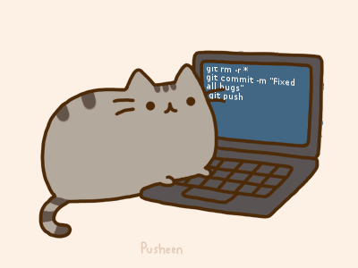

## Hello👋

---

### I'm Zhiwei Li

🌱 An IE Graduate Student. & Open Source enthusiast.

### 🛠 技术栈 | Tech Stack

- 💻 &#160; 

- 🛢 &#160; 

- 🔧 &#160;

- :cloud: 
  

### 开源项目 | Open Source Projects
- [轻小说EPUB下载器](https://github.com/mj3622/Wenku8Downloader)
- [轻小说更新提醒](https://github.com/mj3622/NoveliaReminder)
- [PicHub免费图床服务](https://github.com/mj3622/PicHub)
- [情感分析系统Emoprobe](https://github.com/pxxxl/Emoprobe)
- [智能家居系统安卓App](https://github.com/mj3622/SmartHomeApp)

### 正在做的事 | Currently Working On
- Keep studying

> ***I love to make friends. so if you want to say hi, I'll be happy to meet you more!😊***

⭐️ From [minjer](https://github.com/mj3622)
